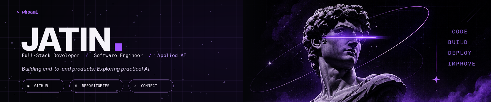
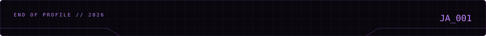

 

&nbsp;

&nbsp;

 

<table>
<tr>
<td width="34%" valign="top">

###  01 / ABOUT ME

I'm a full-stack developer working across frontend, backend APIs, databases, authentication and deployment.

At **AV Technosys**, I work on real-world applications and production delivery — from building interfaces and integrating services to debugging issues and improving application workflows.

I enjoy understanding how the pieces of a product fit together and taking features from implementation through production.

</td>
<td width="44%" valign="top">

###  02 / TECH STACK

**LANGUAGES & FRONTEND**

**BACKEND & DATABASES**

**CLOUD & DEVELOPMENT TOOLS**

Also worked with: Drizzle ORM · REST APIs · JWT authentication · AWS S3 · EC2 · CloudFront · React Native · Expo

</td>
<td width="22%" valign="top">

###  03 / CURRENT FOCUS

`01` System design

`02` AI-powered applications

`03` Backend architecture

`04` Production debugging

`05` Cloud deployment

 

</td>
</tr>
</table>

---

###  04 / GITHUB ACTIVITY

<table>
<tr>
<td width="33%" valign="middle">

</td>
<td width="33%" valign="middle">

</td>
<td width="34%" valign="middle">

</td>
</tr>
</table>

---

<table>
<tr>
<td width="70%" valign="top">

###  05 / CONTRIBUTION LOOP

AUTOMATICALLY REGENERATED BY GITHUB ACTIONS

<picture>
  <source media="(prefers-color-scheme: dark)" srcset="https://raw.githubusercontent.com/Jatinn07/Jatinn07/output/github-snake-dark.svg"/>
  <source media="(prefers-color-scheme: light)" srcset="https://raw.githubusercontent.com/Jatinn07/Jatinn07/output/github-snake.svg"/>
  
</picture>

</td>
<td width="30%" valign="top">

###  06 / CONNECT

For collaboration, technical conversations or questions, the best public starting point is my GitHub profile.

 

  

  

Let's build something meaningful.

</td>
</tr>
</table>

DESIGNED WITH INTENT · ENGINEERED WITH CURIOSITY · JATIN / 2026

